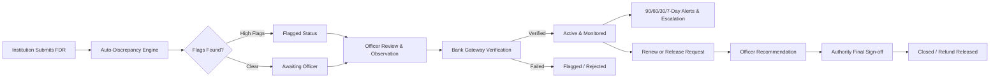

# FDR Management Portal

[](https://sih.gov.in)
[]()
[]()
[](https://nodejs.org)
[]()

> A secure, centralized, and tamper-evident digital portal for managing the complete lifecycle of AICTE Security Deposits and Fixed Deposit Receipts (FDRs).

---

## 📌 Problem Statement & Overview

In traditional workflows, regulatory bodies (like AICTE) and affiliated educational institutions process security deposits and FDRs manually using physical certificates, courier deliveries, and spreadsheet records. This leads to:
* **Forged or duplicate FDR submissions.**
* **Untracked maturities** resulting in dormant deposits or missed renewals.
* **Complex, opaque refund/release workflows** prone to delays.
* **Lack of auditability** and risk of data tampering.

### The Solution:
The **FDR Management Portal** provides an end-to-end digital lifecycle:



---

## 🚀 Core Features

| Feature | Description | Implementation |
|---|---|---|
| **Two-Tier Trust Model** | Receipts submitted by institutions remain unverified until officially validated via bank integration. | `bankStatus` + Trust panel in UI |
| **Tamper-Evident Audit Trail** | Blockchain-style append-only ledger where every event stores the SHA-256 hash of the previous record. Zero delete endpoints. | [`src/audit.js`](file:///e:/lakshy%20college/SIH/fdr-portal/fdr-portal/fdr-portal/src/audit.js) |
| **Discrepancy Engine** | Automatic validation catches duplicate FDR numbers/banks, reused documents, bad amounts, and impossible dates. | [`src/discrepancy.js`](file:///e:/lakshy%20college/SIH/fdr-portal/fdr-portal/fdr-portal/src/discrepancy.js) |
| **Maturity Escalation Ladder** | Automated reminders at 90, 60, 30, and 7 days. Escalates unaddressed FDRs to officers, senior administrators, and overdue queues. | [`src/alerts.js`](file:///e:/lakshy%20college/SIH/fdr-portal/fdr-portal/fdr-portal/src/alerts.js) |
| **Cryptographic File Security** | Validates magic byte signatures (rejecting disguised files) and binds a SHA-256 checksum to each upload, verified upon download. | [`server.js`](file:///e:/lakshy%20college/SIH/fdr-portal/fdr-portal/fdr-portal/server.js) |
| **Multi-Level Release Approvals** | Level 1: Officer review & recommendation. Level 2: Final authority approval (mandatory remarks required for premature releases). | Multi-tier RBAC in `server.js` |
| **Pluggable Bank Gateway** | Modular interface ready for real Core Banking System (CBS) APIs; includes a mock gateway with simulated fraud detection. | [`src/bank.js`](file:///e:/lakshy%20college/SIH/fdr-portal/fdr-portal/fdr-portal/src/bank.js) |

---

## 🛠️ Quick Start & Local Setup

### Prerequisites
* **Node.js** (v18.0.0 or higher)
* **npm** (v9.0.0 or higher)

### 1. Clone & Install
```bash
git clone https://github.com/YOUR_USERNAME/fdr-management-portal.git
cd fdr-management-portal
npm install
```

### 2. Start the Server
```bash
npm start
```
The portal will be live at: **`http://localhost:3000`**

### 3. Run Automated Tests
```bash
npm test
```
*Runs the end-to-end smoke test validating auth, submission, duplicate prevention, verification, release approvals, and audit chain integrity.*

### 4. Reset Demo Data
```bash
npm run reseed
```
*Resets the local database (`data/db.json`) back to clean initial demo records.*

---

## 👥 Demo Accounts & Credentials

The portal features an interactive **1-click autofill panel** on the login screen. You can also sign in manually using any of the accounts below:

> **Universal Password for all demo accounts:** `demo123`

| Role | Email | Organization | Access Privileges |
|---|---|---|---|
| **AICTE Officer** | `officer@demo.in` | AICTE Central | Review submissions, verify documents, trigger bank confirmation, recommend releases, view audit trail |
| **Authority / Admin** | `admin@demo.in` | AICTE Directorate | Final release approval, alert threshold configuration, user management, full audit inspection |
| **Institution 1** | `bit@demo.in` | Bhopal Institute of Technology | Submit FDRs, view institutional dashboard, request renewals, request releases |
| **Institution 2** | `sagar@demo.in` | Sagar College of Engineering | Submit FDRs, track active deposits |

---

## 🎯 3-Minute Demo Guide for Evaluators

1. **Sign in as AICTE Officer (`officer@demo.in`):**
   * Review the **Today** dashboard highlighting records that need immediate attention.
   * Open the flagged record (`FAKE/BPL/2025/000001`).
   * Select **Verify documents** $\rightarrow$ Click **Confirm with bank**.
   * Notice that the mock bank gateway catches and flags the fake receipt with an error.

2. **Sign in as Institution (`bit@demo.in`):**
   * Click **Submit an FDR**.
   * Enter a new FDR number: `SBI/BPL/2026/884102`, Bank: `State Bank of India`, Amount: `₹15,00,000`, attach any sample PDF/image, and submit.
   * Try submitting the exact same FDR number again $\rightarrow$ Observe the automated duplicate prevention block (`409 Conflict`).

3. **Verify as Officer:**
   * Log back in as `officer@demo.in`.
   * Open the newly submitted FDR $\rightarrow$ **Verify documents** $\rightarrow$ **Confirm with bank**.
   * The status transitions to **Active** and **Verified by bank**.

4. **Multi-Level Release:**
   * As the institution (`bit@demo.in`), open an Active FDR and click **Request release**.
   * As officer (`officer@demo.in`), review and click **Recommend release**.
   * As admin (`admin@demo.in`), grant **Final approval** (written remarks required if premature) $\rightarrow$ FDR status transitions to **Closed**.

5. **Audit Trail Verification:**
   * Navigate to **Audit trail** as `admin@demo.in` to observe the SHA-256 hash-chain verifying that history has not been tampered with.

---

## 📂 Project Architecture

```
fdr-portal/
├── server.js            # Express application, JWT authentication, RBAC, REST API
├── package.json         # Project metadata, scripts, and dependencies
├── src/
│   ├── store.js         # Centralized datastore layer (JSON database abstraction)
│   ├── audit.js         # Append-only SHA-256 cryptographic audit chain
│   ├── discrepancy.js   # Automated discrepancy & validation rules engine
│   ├── alerts.js        # Daily maturity checker, 90/60/30/7-day alerts & escalation
│   ├── bank.js          # Pluggable bank gateway adapter (mock adapter included)
│   ├── seed.js          # Initializer for mock institutions, officers, and FDR records
│   └── reseed.js        # Script to reset demo database
├── public/              # Lightweight Single-Page App (Zero build step required)
│   ├── index.html       # HTML entry shell
│   ├── app.js           # Client-side router, view rendering, 1-click test buttons
│   └── style.css        # Clean UI design system with responsive layouts
├── test/
│   └── smoke.js         # End-to-end integration and smoke test suite
└── uploads/             # Disk storage for uploaded FDR documents (PDF, PNG, JPG)
```

---

## 🌐 Cloud Deployment Guide

### Deploy to Render (Free Web Service)
1. Push this project to a GitHub repository.
2. Sign in to [Render.com](https://render.com) and click **New + $\rightarrow$ Web Service**.
3. Select your repository and configure:
   * **Runtime:** `Node`
   * **Build Command:** `npm install`
   * **Start Command:** `npm start`
4. Set Environment Variables:
   * `PORT`: `3000`
   * `JWT_SECRET`: `your-custom-production-secret`
5. Click **Deploy Web Service** to receive your public HTTPS link.

### Instant Tunnel (30-second local testing)
```bash
npx localtunnel --port 3000
```

---

## 🔒 Security Best Practices Implemented
* **Zero Deletion Architecture:** No API route exists to delete an FDR or an audit record.
* **Cryptographic Hash Chaining:** Any database modification outside the application breaks the audit verification chain.
* **Magic-Byte Document Verification:** Checks the initial bytes of uploaded files to ensure disguised executables cannot be submitted.
* **Role-Based Access Control (RBAC):** Strict separation between Institutions, AICTE Officers, and Authority Administrators.
* **Cryptographic Password Hashing:** All credentials secured using `bcryptjs`.

---

## 📜 License
Developed for **Smart India Hackathon (SIH 2026)**. Distributed under the MIT License.
